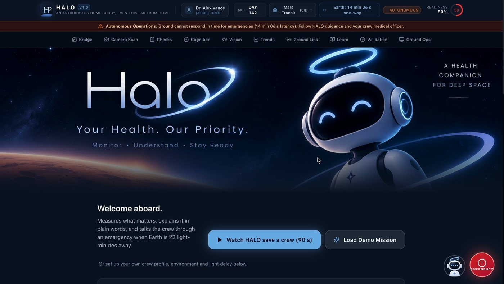
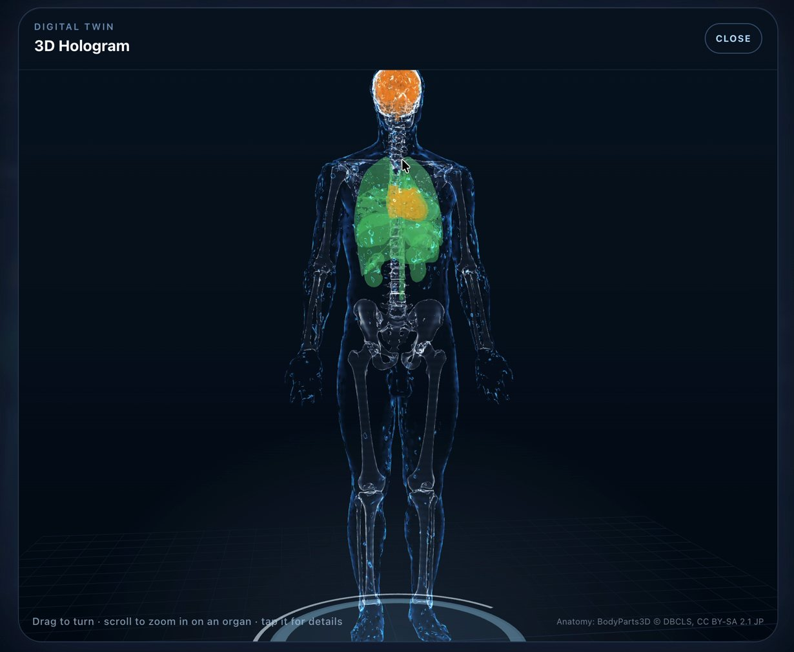
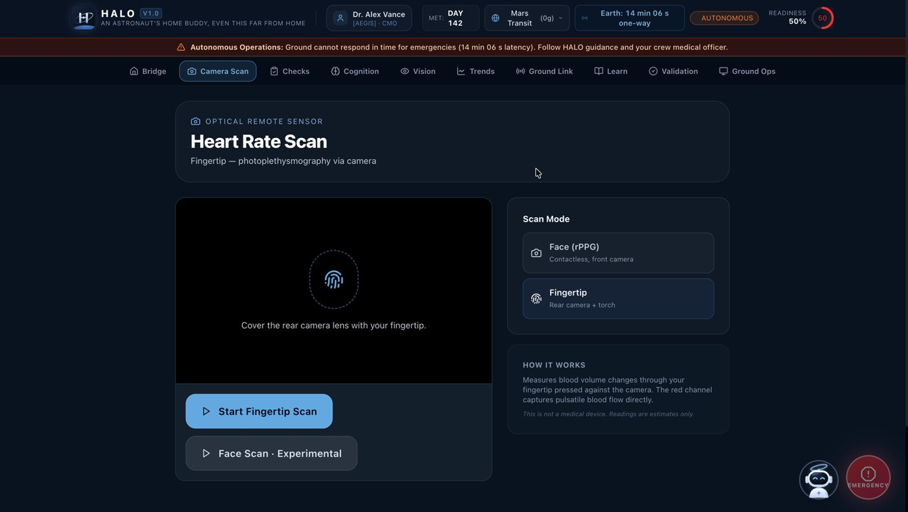
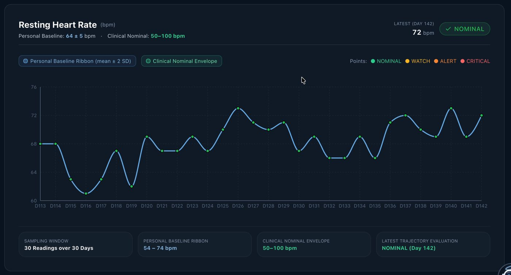
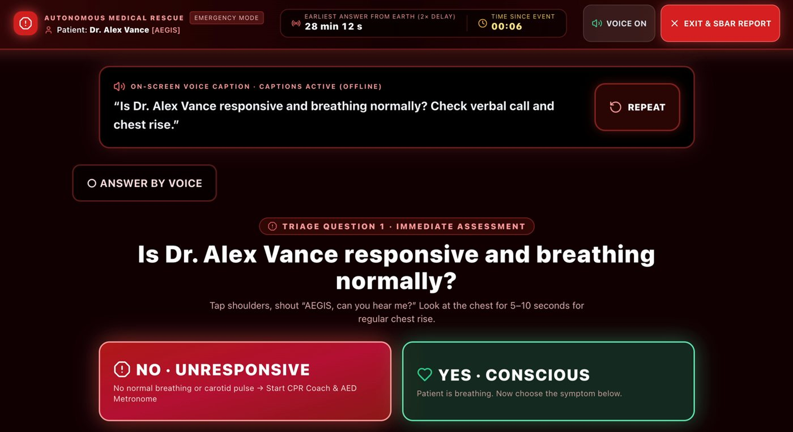
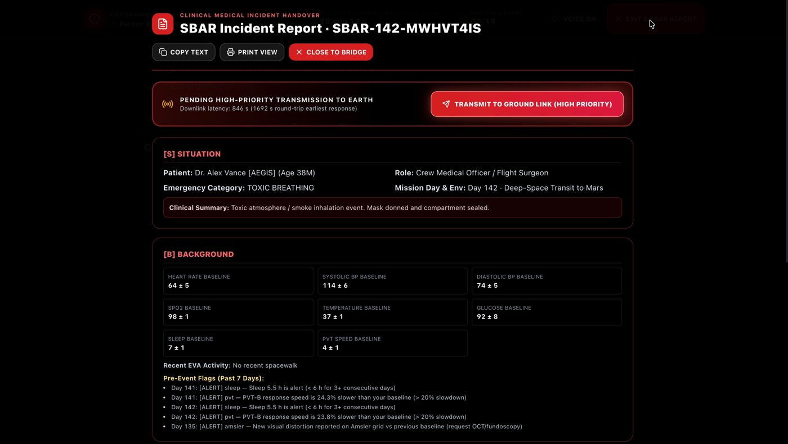

# HALO — Health Autonomy for Long-duration Operations

*An astronaut's home buddy, even this far from home.*



**NASA Space Apps Challenge 2026 · Challenge: "Create health monitoring software for astronauts" (Brazilian Space Agency)**

**Live app:** https://halo-meowenor.vercel.app/ — open in Chrome, click **Load Demo Mission**, then **Judge Mode** for a 90-second narrated tour.
**Team:** _Lynxstation_ · Hyderabad, India

> On a Mars mission the flight surgeon is up to 22 light-minutes away. If a crewmate collapses, the earliest possible answer from Earth arrives after the moment that matters. **HALO is an offline-first health co-pilot** that lets astronauts measure, understand and act on their own health, and talks the crew through an emergency when Earth cannot answer in time. The farther from Earth, the more HALO takes over.

> ⚠️ Prototype built for NASA Space Apps. **Not a medical device.** Readings are estimates; all demo-mission data is simulated and labelled as such.

---

## Contents

1. [The problem](#the-problem)
2. [A tour of HALO](#a-tour-of-halo)
3. [How HALO answers the challenge](#how-halo-answers-the-challenge)
4. [Full feature list](#full-feature-list)
5. [How the health logic works](#how-the-health-logic-works)
6. [NASA and partner resources used](#nasa-and-partner-resources-used)
7. [Validation](#validation)
8. [Run it locally](#run-it-locally)
9. [Architecture and tests](#architecture-and-tests)
10. [Beyond space](#beyond-space)
11. [Honest limits](#honest-limits) · [What's next](#whats-next) · [Use of AI](#use-of-ai-super-intelligence-in-the-space-apps-form) · [Credits](#credits) · [Licence](#licence)

---

## The problem

Astronauts are pilots, engineers and scientists — most are not doctors. On the ISS that is manageable: a flight surgeon is less than a second away by radio. On the way to Mars it is not:

| Where | One-way light delay | Earliest answer from Earth |
|---|---|---|
| ISS | under 1 s | immediately |
| Moon base | about 1.3 s | about 3 s |
| Mars transit / Mars base | about 3 to 22 min | **6 to 44 min** |

A cardiac arrest needs chest compressions within a couple of minutes. So crews need a tool that (1) helps a non-doctor take a measurement correctly, (2) says in plain language what the number means **for that person**, (3) says what to do next, and (4) works with no internet and no doctor on the line.

## A tour of HALO

### 1 · The Digital Twin: see the whole crew member at a glance

A clickable human body shows every monitored system. Each status is shown as **colour + icon + word** (NOMINAL / WATCH / ALERT / CRITICAL), so it never depends on colour alone. Click a system to see why it is flagged, how spaceflight affects it, and what to do. The **3D Hologram** opens a rotatable, real anatomical model (brain, eyes, heart, lungs, metabolism, skeleton), with one colour per organ or a health-status view.



### 2 · Measure heart rate with only a camera

Hold a fingertip over the camera for a photoplethysmography reading — no extra hardware. If the signal is poor, HALO shows **no reading** rather than guessing. A contactless face mode is included and clearly marked *experimental*.



### 3 · Trends against the astronaut's own baseline

Every indicator is charted over the mission with the clinical range and the personal baseline band, so slow drifts (the kind that matter on a 3-year mission) are visible long before a threshold is crossed.



### 4 · Emergency mode: one red button, hands-free

"Who needs help?" → a decision clock comparing *time since the event* with *the earliest possible answer from Earth* → voice-guided, captioned protocols: CPR coach with a 110/min metronome and microgravity positions, chest-pain triage with red-flag logic, toxic atmosphere, radiation storm.



### 5 · An automatic handover to Earth

Every emergency ends with an auto-written **SBAR** report (Situation, Background, Assessment, Request) containing the patient's baselines and the last week's flags, ready to transmit through Ground Link with the real light delay.



---

## How HALO answers the challenge

| The challenge asks for | Where it is in HALO |
|---|---|
| A **visual tool** to monitor health | Bridge dashboard with the Digital Twin (2D + 3D hologram) and a single readiness score |
| **How to measure** each indicator | Step-by-step "how to measure" cards in every guided check; built-in tap counter for breathing rate; camera heart-rate scan |
| **Why it matters** | "Why it matters in space" on every check, plus a Learn library organised by NASA's five hazards of spaceflight |
| **What to do if it is abnormal** | Every flag carries a plain-English reason and a next step; nothing is flagged without an explanation |
| **Reminders** | Scheduler marks checks due / overdue; overdue checks lower the readiness score |
| **Different environments** | ISS, Mars transit, Moon base, Mars base, rover — each changes gravity, light delay, radiation rate, equipment and autonomy level |
| **Colour coding** | Four statuses, always colour + icon + word |
| **Charts over time** | Trends page per indicator with baseline band and clinical range |
| **Gamification** | Daily "orbit" ring of checks, XP and a streak for keeping up with them |
| **Emergency guidance** | Emergency mode with voice, captions, CPR metronome and SBAR report |
| Simple enough for **non-doctors** | Plain language throughout; a conversational assistant ("Hey HALO") answers questions, logs spoken readings and reads messages from Earth |

**Against the judging criteria**

- **Impact** — Targets the real gap in exploration medicine: distance from Earth. The same offline tool fits remote clinics, ships, polar stations and disaster zones on Earth.
- **Creativity** — "Unusual for *you*" baselines instead of fixed limits; a decision clock that makes light delay tangible; microgravity CPR coaching; a Ground Link that actually delays messages; a real-anatomy hologram.
- **Validity** — Transparent, rule-based logic (no black box) with thresholds unit-tested one by one; the signal pipeline refuses to output a reading it cannot trust; accuracy is measured in-app, not asserted.
- **Relevance** — Built around NASA Human Research Program hazards, the PVT-B test from NASA's Cognition battery, SANS, and NASA's 600 mSv career radiation limit (details below).
- **Presentation** — Judge Mode plays a 90-second narrated demo on its own; every screen is captioned and keyboard-reachable.

---

## Full feature list

| Feature | Description |
|---|---|
| **Bridge + Digital Twin** | Clickable regions (Brain, Eyes, Heart, Lungs, Metabolism, Bones, Radiation) with status, spaceflight effect and action. 3D hologram with organ-colour and health-status views; the skeleton lights up when Bones is selected. |
| **Heart rate from the camera** | **Fingertip mode**: red-channel photoplethysmography, Butterworth band-pass, zero-padded FFT, SNR quality gate. **Face mode** (MediaPipe face landmarks + POS algorithm) is *experimental*. |
| **Guided checks** | Blood pressure, SpO₂, temperature, glucose, respiratory rate, sleep, mood, PHQ-2 / GAD-2. |
| **"Unusual for *you*"** | Each value is judged against clinical ranges **and** the astronaut's own baseline (z-score with per-indicator SD floors, 7-day trend). |
| **PVT-B cognition test** | 3-minute psychomotor vigilance test after NASA's Cognition battery, timed with `requestAnimationFrame`; detects fatigue before you feel it. |
| **Amsler grid** | Screen-calibrated vision self-check for SANS; compares each eye with its previous map. |
| **Readiness score** | One number with a visible breakdown: GO / GO WITH CAUTION / HOLD. |
| **Radiation + storm shelter** | Cumulative dose against the 600 mSv career limit; Solar Particle Event shelter protocol. |
| **Emergency mode** | Patient picker, decision clock, voice answers ("no, she's not breathing"), CPR coach (110/min, restraint / Evetts-Russomano / handstand positions), chest pain, toxic atmosphere, radiation storm, SBAR report. |
| **Ground Link** | Alerts and reports travel to a simulated flight-surgeon console with a time-compressed light delay; replies return the same way. `/split` shows ship and Earth side by side. |
| **HALO assistant** | Type or speak. Answers health questions from the on-board library and your own readings, logs spoken readings through the same rules engine, starts checks or the emergency flow, waits when asked. |
| **Validation page** | Logs paired readings against a reference and computes MAE, RMSE, % within ±5 bpm and a Bland-Altman plot; CSV export. |
| **Judge Mode** | A 90-second self-running narrated tour. |
| **Offline-first PWA** | Installable; models, fonts, WASM and the 3D anatomy are bundled. |

## How the health logic works

HALO deliberately uses **explainable rules, not a trained model**: on a spacecraft, a crew member must be able to see *why* something was flagged.

1. **Absolute check** — the value is compared with a published clinical range (full table in [`HALO_SPEC.md`](HALO_SPEC.md) §6), with explicit rounding so there are no gaps between bands.
2. **Personal check** — the value is compared with that astronaut's baseline as a z-score. Each indicator has a minimum standard deviation so a very stable person is not flagged for trivial changes.
3. **Trend check** — a 7-day slope catches slow drifts.
4. The **worst** of the three becomes the status, and the reason that produced it is shown first.
5. **Readiness** starts at 100 and subtracts 30 per CRITICAL, 15 per ALERT, 5 per WATCH and 3 per overdue check; the breakdown is always visible.

Camera heart rate: capture → region of interest → (POS for face / red channel for fingertip) → band-pass 0.7–3.5 Hz → FFT → signal-to-noise gate → BPM, all in a Web Worker.

## NASA and partner resources used

| Resource | How HALO uses it |
|---|---|
| **NASA Human Research Program — the five hazards of human spaceflight** | Structure of the Digital Twin, the Learn library and the environment profiles |
| **NASA Cognition test battery (PVT-B)** | The reaction-time test follows the published PVT-B protocol |
| **Spaceflight Associated Neuro-ocular Syndrome (SANS)** — NASA HRP | Motivates the Amsler-grid vision screen |
| **NASA space-permissible exposure limit: 600 mSv career (2022)** | Radiation panel and readiness logic |
| **Curiosity RAD** (Mars transit / surface dose rates) and **Chang'e-4 LND** (lunar surface) | Dose rates per environment |
| **NASA Open Science Data Repository — Inspiration4** | Studied to understand which crew measures are collected in flight |
| **Challenge page resources (Brazilian Space Agency)** | Feature checklist above |

Stated plainly: HALO uses NASA **research findings, protocols and published limits** as its core. It does **not** yet ingest a NASA dataset; all mission readings in the demo are simulated and labelled.

## Validation

The **Validation** page logs paired readings (HALO camera BPM vs a reference taken at the same moment) and computes the error statistics from them. Nothing on that page is pre-filled.

Readings collected by the team during the hackathon (fingertip mode, counted wrist pulse as reference):

| Readings (n) | Mean abs. error | Within ±5 bpm |
|---|---|---|
| _N_ | _X.X bpm_ | _Y %_ |

_Fill in from the Validation page before submission._

## Run it locally

```bash
npm install
npm run build && npm run preview   # offline/PWA behaviour only works on the built app
npm run test                       # Vitest unit tests
```

Open the printed URL in **Chrome** (camera, speech and the metronome were tested there). The camera needs `localhost` or HTTPS. Click **Load Demo Mission** to explore "Ares Mars Transit, Day 142" with simulated data.

## Architecture and tests

```
src/
  config/      environments, clinical thresholds, Learn library
  engine/      rules (absolute + personal baseline + trend), readiness, scheduler
  sensors/rppg capture → ROI → POS / red channel → band-pass → FFT → SNR gate (Web Worker)
  features/    bridge, scan, checks, cognition, vision, trends, emergency,
               groundlink, learn, validation, judge, onboarding
  ground/      flight-surgeon console and split view
  data/        Dexie (IndexedDB) schema + deterministic demo mission
scripts/       build_human_glb.py — reproducible build of the 3D anatomy
```

**Stack:** Vite · React 18 · TypeScript (strict) · Tailwind · Dexie · MediaPipe Tasks Vision · three.js / react-three-fiber · Recharts · Web Speech API · Workbox PWA · Vitest.

**Tests:** more than 100 unit tests across 21 files cover every threshold boundary, baseline and trend logic, the signal-processing pipeline (synthetic pulse recovery), PVT scoring, emergency triage logic, the assistant's intent parsing, validation statistics and the demo seed.

## Beyond space

The constraints of deep space — no doctor, no connection, non-expert users — are the constraints of a village health post, a fishing vessel or an Antarctic station. HALO runs on any phone or laptop with a camera and a browser, offline, which makes the same approach usable for remote and under-served communities on Earth.

## Honest limits

- Prototype only; not validated for clinical use.
- Face-mode heart rate is experimental and often rejected by the quality gate; fingertip mode is the recommended method.
- The camera does **not** estimate blood pressure, SpO₂, HRV or stress — a 30 fps webcam cannot do these reliably. Those values are entered from the crew's instruments.
- Voice *recognition* uses the browser's speech service (Chrome / Edge), which needs a connection; every other feature, including spoken guidance, runs offline. Buttons always work.
- No drug names or doses are hard-coded; emergency steps defer to the onboard medical checklist and flight surgeon.
- Thresholds come from published adult clinical ranges and have not been reviewed by a flight surgeon.

## What's next

- Import real in-flight datasets from NASA's Open Science Data Repository to tune baselines.
- Bluetooth pairing with a pulse oximeter and blood-pressure cuff.
- On-device speech recognition so voice answers work offline.
- Review of protocols and thresholds by aerospace-medicine clinicians.

## Use of AI ("Super Intelligence" in the Space Apps form)

AI coding assistants (Google Antigravity with Gemini and Claude models, and Anthropic's Claude) were used to generate and refactor code, tests and documentation from a human-written specification (`HALO_SPEC.md`). The concept and feature set were developed by the team in dialogue with AI tools; all medical thresholds were specified and checked by the team, every feature was reviewed and tested by the team, and the voice in the app is the device's own text-to-speech. The cover banner and the HALO buddy avatar (`public/brand/`) are AI-generated illustrations; the banner carries its generator's visible watermark as the Space Apps rules require. No NASA branding is used.

## Credits

- **3D anatomy model** (`public/models/human.glb`): derived from [BodyParts3D](https://dbarchive.biosciencedbc.jp/en/bodyparts3d/), © 2008 Life Science Integrated Database Center (DBCLS), licensed **CC BY-SA 2.1 Japan**. Skin, skeleton and organs were selected and simplified for the web by the HALO team with `scripts/build_human_glb.py`; the derived model is shared under the same licence.
- Mesh files were obtained via [Kevin-Mattheus-Moerman/BodyParts3D](https://github.com/Kevin-Mattheus-Moerman/BodyParts3D).
- Open-source libraries: React, Vite, Tailwind CSS, Dexie, MediaPipe, three.js, react-three-fiber, drei, Recharts, Framer Motion, Lucide, Workbox, Vitest.

## Licence

Code: [MIT](LICENSE). The 3D anatomy model is CC BY-SA 2.1 Japan (see Credits).
